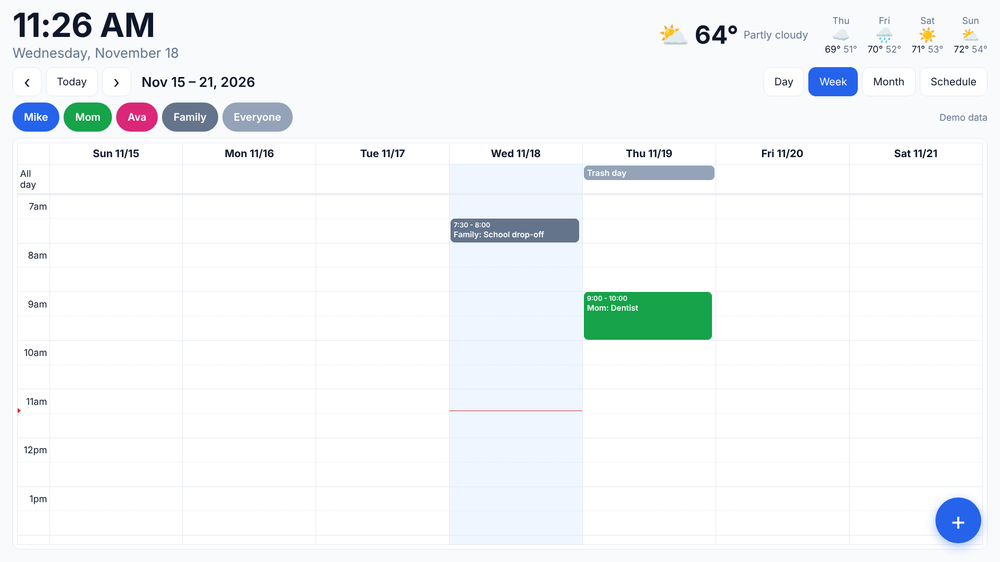

# Family Calendar

A wall-mounted family calendar for a touchscreen monitor and a Raspberry Pi: a self-hosted
alternative to the Skylight Calendar. It syncs the shared **Poche Family** Google calendar,
colours events by family member, and shows weather.



## What works now (phase 1)

- Two-way sync with one Google calendar through a service account (pull every 5 minutes, writes go straight to Google)
- Day, week, month and two-week schedule views, sized for touch
- Colour per family member, from the event title (`Mike: Dentist`), with filter chips
- Family settings on the wall: rename, pick a colour and one of 12 animal avatars, add or remove people
- Shared grocery list: add from the wall or any phone, tap to check off, clear checked; duplicates are ignored
- Photo screensaver after 10 idle minutes, with photos chosen through the Google Photos Picker (QR code to pick on your phone) or copied into `data/photos/`
- Add, edit and delete events on the screen; picking a person adds the `Name:` prefix
- Clock, date, current weather and 4-day forecast (Open-Meteo, no key needed)
- Live refresh: changes show on every open screen within a second
- Returns to this week after 2 minutes untouched
- Demo mode with sample events when no Google credentials are configured

Planned next: chores, marble jars, phone layout as an installable app, meal planning, and forwarding school emails to create events. See the strategy doc in the
project for the full plan.

## Layout

| Path | What |
| --- | --- |
| `backend/` | Python FastAPI app, SQLite storage, Google sync, weather |
| `frontend/` | React + FullCalendar wall UI (built into the Docker image) |
| `kiosk/` | Raspberry Pi setup, Chromium kiosk launcher, night-mode screen control |
| `docs/` | Google and Raspberry Pi setup guides |

## Set up

1. [Raspberry Pi kiosk](docs/pi-setup.md)
2. [Connect the Google calendar](docs/google-setup.md)
3. [Photo screensaver](docs/photos-setup.md) (optional)

## Develop

```bash
# backend (demo mode, no Google needed)
cd backend
python3 -m venv .venv && . .venv/bin/activate
pip install -r requirements-dev.txt
pytest -q
DATA_DIR=./data PEOPLE="Mike:#2563eb,Mom:#16a34a,Kid:#db2777" uvicorn app.main:app --reload

# frontend, in another terminal: http://localhost:5173
cd frontend
npm install
npm run dev
```

## API

| Method | Path | |
| --- | --- | --- |
| GET | `/api/health` | mode (`demo`/`google`), last sync time, last error |
| GET | `/api/events?start=&end=` | events overlapping the range (ISO dates) |
| POST / PATCH / DELETE | `/api/events[/{id}]` | create, edit, delete (written to Google) |
| GET / POST / PATCH / DELETE | `/api/people[/{id}]` | family members and colours |
| GET / POST / PATCH / DELETE | `/api/grocery[/{id}]` | grocery items; `POST /api/grocery/clear-checked` removes checked ones |
| GET | `/api/weather` | current conditions and forecast |
| POST | `/api/sync` | sync with Google now |
| GET | `/api/stream` | Server-Sent Events: `changed` when data changes |
