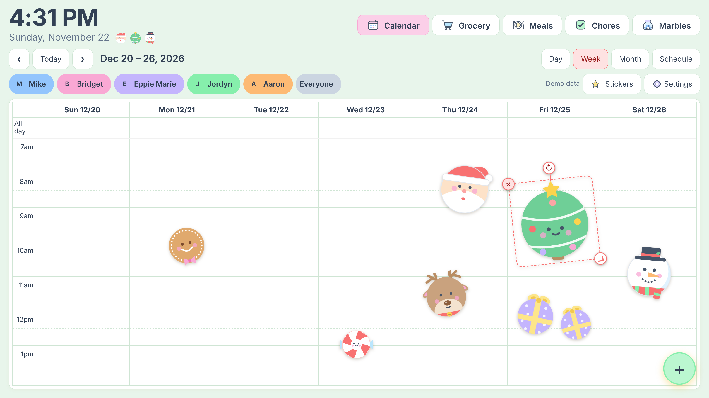

# Calendar stickers

Decorate the calendar with stickers, like a tree on Christmas or a turkey on Thanksgiving, without adding anything to Google Calendar.

## Add a sticker

1. On the Calendar page, tap **Stickers** (next to Settings).
2. Pick an icon. Any of the app's icons works, all year round. When a holiday theme is on, that holiday's icons are listed first.
3. Tap the day you want it on. It lands right where you tapped.

## Move, resize, turn and remove

Tap a sticker to select it. A dashed box appears around it.

- **Move:** drag it anywhere. It stays exactly where you let go. Drop it on a different day and it moves to that day.
- **Resize:** drag the round corner handle at the bottom right, or pinch with two fingers.
- **Turn:** drag the ↻ handle above it, or twist with two fingers.
- **Remove:** tap the **×** at the top left. With a keyboard, press Delete.
- **Done:** tap anywhere else on the calendar (or press Escape).

While a sticker is selected, taps on the calendar only finish editing, so you won't open an event by accident. Once nothing is selected, the calendar works as usual. A sticker sitting on top of an event covers it, so drag it aside if you need that event.

## How they follow the date

Each sticker belongs to the day you dropped it on and remembers where it sits inside that day. When you change weeks or switch between Day, Week and Month, it shows on that day in the same spot, scaled to the size of the day box. In the Schedule view, a day's stickers show as small icons next to the date (only days that have events appear there).

## Where they're saved

Stickers are saved in the app's own database on the backend machine, so the wall screen and every phone or iPad show the same stickers and update within a second when someone changes one. They are never sent to Google Calendar, so they don't show up in the Google Calendar app. Stickers stay until you remove them.
