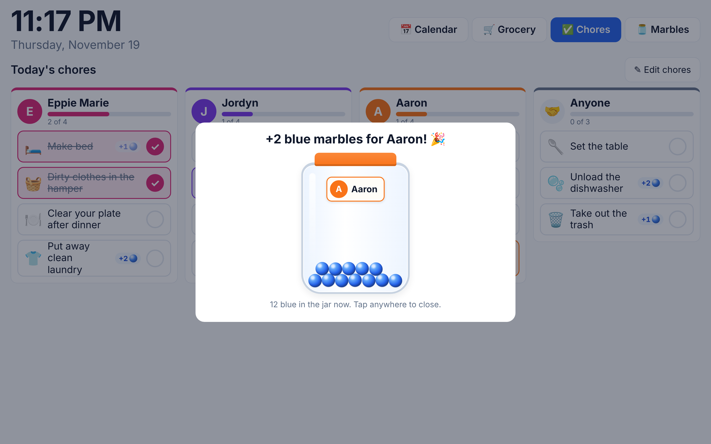

# Marbles for chores

A chore can be worth blue marbles. When a kid checks it off on the wall, that many blue marbles
drop into their jar right away. If someone taps a chore by mistake, tapping it again takes the
marbles back.

## Setting a chore's marble value

1. Open **Chores** and tap **✎ Edit chores**.
2. Each chore row has a small counter with a blue marble next to it. Tap **+** or **−** to set how
   many blue marbles the chore earns (0 to 20). It saves as soon as you tap.
3. Leave it at **0** for chores that don't earn marbles. Those work exactly like before.
4. Tap **Done**.

New chores (the **+ Add chore** button) start at 0, so set the value after you name the chore.

On the chores screen, a chore that earns marbles shows a little **+2 🔵** badge, so the kids can
see what it's worth before they do it.

## What happens when a chore is checked off

- **A kid's own chore** (in their column): their jar gets the blue marbles. A popup shows their jar
  with the new marbles dropping in, then closes by itself after about 3 seconds (or tap anywhere).
- **An "Anyone" chore**: the wall asks who did it, as before. The popup in that step also says how
  many marbles it's worth. Whoever you pick gets them.
- **No jar, no marbles.** If the person doesn't have a marble jar (Mike and Bridget, for example),
  the chore is checked off and nothing else happens.
- Chore marbles are always **blue** (good, spendable). They show up in the Marbles screen like any
  other blue marble and can be spent on rewards. Nothing resets.

## Taking marbles back (misclicks)

Tap a checked chore again to uncheck it. The marbles it gave are taken back from the same jar, and
a short note at the bottom of the screen says so ("Took back 2 blue marbles from Aaron's jar").

A few details, so nothing surprising happens:

- If nothing else happened to that jar since, the award is simply erased, as if it never happened.
- If the kid already got other marbles after it, the newest blue marbles are taken off the top.
  White marbles are never touched.
- If some of those blue marbles were already spent, only what's left is taken. A jar never goes
  below zero.
- If you already pressed **↶ Undo last** on the Marbles screen to remove the award, unchecking the
  chore won't take a second batch.
- If you switch an "Anyone" chore to a different kid (uncheck, then check and pick someone else),
  the first kid's marbles go back and the second kid gets them.

## Changing the value later

Changing a chore's marble value only affects future check-offs. Marbles already given today stay
as they are; if that chore is unchecked, the amount it actually gave is what gets taken back.

Each day starts fresh at midnight: chores uncheck themselves, but the marbles stay in the jars.
