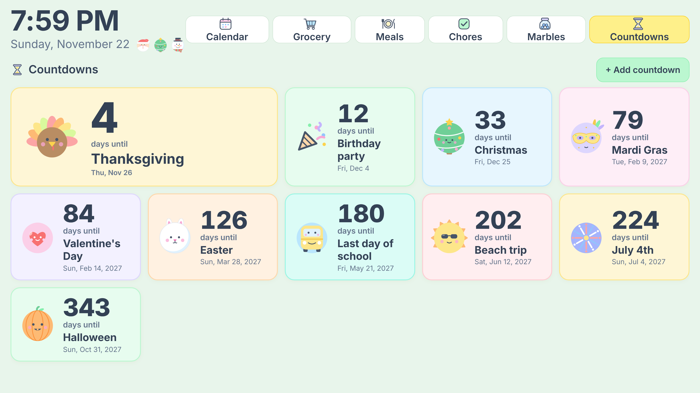

# Countdowns

The **Countdowns** tab counts the days to things the family is looking forward to: "33 days until Christmas", birthdays, trips, the last day of school. It works the same on the wall screen and on phones.

## Adding one

1. Tap **Countdowns**, then **+ Add countdown**.
2. Tap the icon square to pick an icon (all the everyday and holiday icons are there), and type a name.
3. Pick how it repeats:
   - **Just once**: a trip or the last day of school. Once it has passed it moves to "Already happened" so you can remove it.
   - **Every year on this date**: birthdays and fixed holidays. The day after, it starts counting to next year.
   - **Every year on Mardi Gras / Easter / Thanksgiving**: these move around, so the calendar works out the date each year.
4. Pick the date and tap **Save**.

**Add holidays** (shown until Christmas and Halloween are on the list) adds Christmas, Mardi Gras, Valentine's Day, Easter, July 4th, Halloween and Thanksgiving in one tap. It skips any already there.

Tap a card to change it or remove it.

## On the calendar screen

The next two countdowns show as pills above the calendar (one on phones and narrower screens). Tap one to open the Countdowns page. On the day itself the card says **Today!** and the icon bounces.

Countdowns are saved in the app only. They are never added to Google Calendar.
