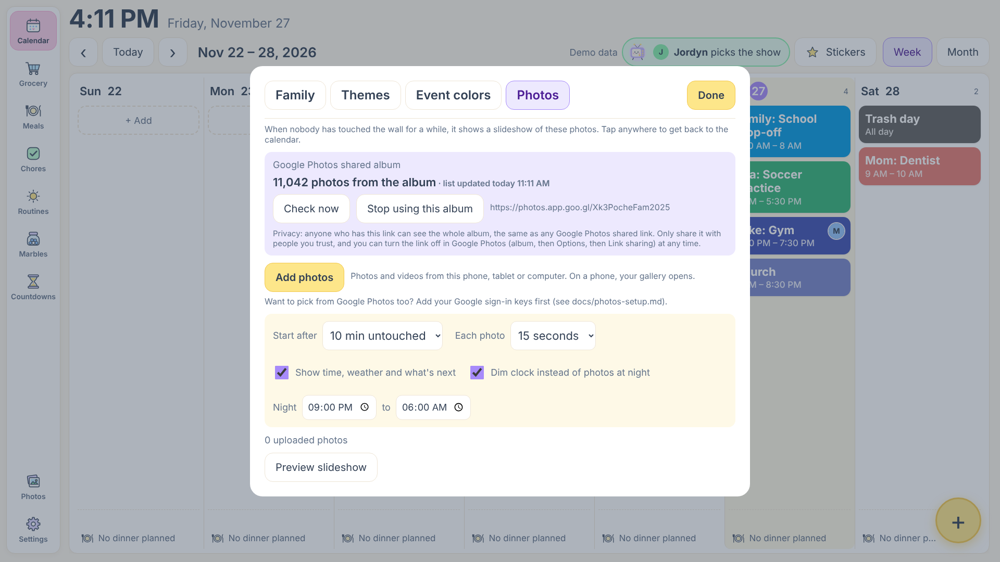

# Google Photos shared album in the slideshow

The slideshow can show photos from a Google Photos **shared album**, even a huge one (it's built
for albums of 10,000+ photos). Nothing is downloaded or stored on the calendar computer: it keeps
only the list of photo links, and the wall loads each photo straight from Google just before it
shows.

## Setting it up (about 2 minutes)

1. On your Android phone, open **Google Photos** and go to the album.
2. Tap the **Share** icon, then **Create link** (or **Copy link** if the album already has one).
   The link looks like `https://photos.app.goo.gl/AbCd1234`.
3. On the wall (or the calendar on your phone), open **Settings > Photos**.
4. Paste the link into **Google Photos shared album** and tap **Use this album**.
5. It says "Reading the album…" for about a minute on a big album, then shows how many photos it
   found. The next slideshow uses them.

You can paste Google's whole share message; the calendar picks the link out of it.

## How it works

- **Once a day** the calendar reads the album's public page and saves the list of photo links
  (about 1.5 MB of text for 11,000 photos). Photos you add to the album show up after the next
  daily check, or straight away if you tap **Check now**.
- When the slideshow runs, the wall asks for a few photos at a time, picked at random from the
  album **and** any photos uploaded to the wall. No photo repeats until every one has had a turn.
- The wall loads only the photo on screen plus the next few, each sized for the screen, straight
  from Google. Nothing piles up on the PC or the Pi.

## Privacy

Anyone who has the album link can see the whole album. That's how Google Photos link sharing
works, whether or not the calendar uses it. Share the link only with people you trust. You can turn
the link off at any time in Google Photos: open the album, tap the three dots, **Options**, and
switch off **Link sharing**. The slideshow then falls back to your uploaded photos.

The calendar has no login, so like the rest of it, keep it on your home network and Tailscale only
(never port-forward it to the internet).

## When something goes wrong

This uses the same public web page you see when you open the link in a browser, not an official
Google API (Google's 2025 changes stopped apps reading existing albums). Google can change that
page, so the calendar is careful:

- **A daily check fails:** it keeps the last list that worked and tries again in about 3 hours.
  Settings > Photos shows the problem in red.
- **Only part of the album could be read:** it keeps the bigger, older list. If there was no older
  list, it uses what it got.
- **Photos stop loading on the wall** (for example Google changed its links): after 5 photos in a
  row fail, that slideshow switches to your uploaded photos and asks for a fresh list.
- **Nothing works at all:** the slideshow uses the uploaded photos, as before.

If it stays red for more than a day, tell Claude what Settings > Photos says; the reader may need
updating for Google's new page format.

## Stop using the album

Settings > Photos > **Stop using this album**. The saved list is deleted. Uploaded photos stay.
