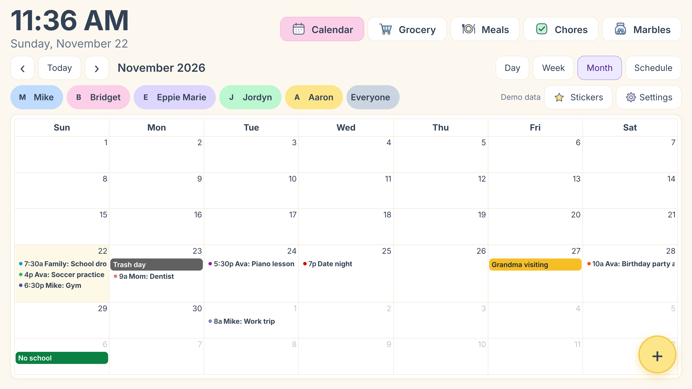

# Event colors from Google Calendar

The wall calendar shows each event in the color it has in Google Calendar, so it looks the same on
the wall as in the Google app on your phone.

- **Pick a color in Google Calendar** (open the event, then the color dot) and the wall picks it up
  on the next sync, within a couple of minutes.
- **Or pick it on the wall.** Tap an event, choose one of Google's 11 colors under **Color**, and
  tap Save. The color is saved to Google too.
- **No color picked** (the striped "Calendar default" circle): the event shows in the family
  member's color if its title starts with a name ("Jordyn: Dance"), otherwise light grey.

Family member colors from Settings are still used everywhere else: the name chips above the
calendar, marble jars, chores, and the Who buttons in the event form.

After updating, events show their Google color once the first sync finishes.
