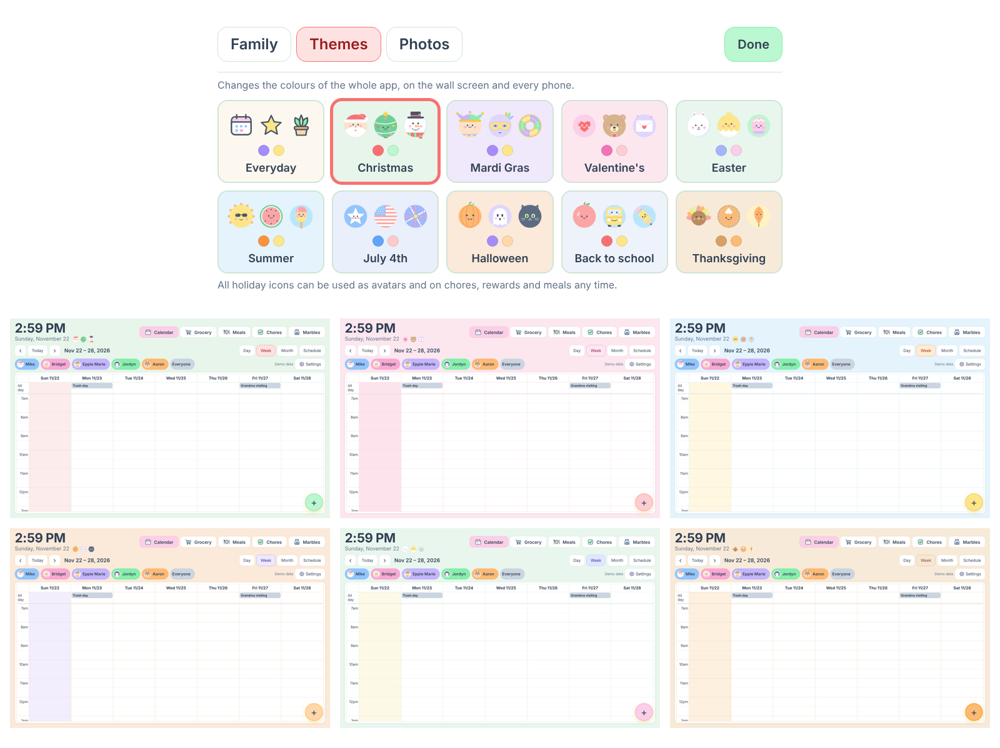

# Holiday themes and icons



## Change the theme

1. Tap **Settings**, then the **Themes** tab.
2. Tap a theme. The whole app changes colour right away, on the wall screen and on every phone.
3. Tap **Everyday** to go back to the normal cream and lilac look.

Themes: Everyday, Christmas, Mardi Gras, Valentine's, Easter, Summer, July 4th, Halloween, Back to school and Thanksgiving. While a holiday theme is on, three of its icons sit next to the date at the top of the wall screen.

## Change a theme's background

Each theme can have its own background colour, for example a darker green for Christmas.

1. In **Settings > Themes**, turn on the theme you want to change.
2. Under **"<theme> background"**, tap one of the shades (lightest to darkest), or tap the **+** circle to pick any colour.
3. Tap **Reset** to go back to the theme's own background.

The colour is saved for that theme only, and the wall and phones change together. On a dark background the clock and headings switch to white text so they stay easy to read.

## Holiday icons

There are 60 original holiday icons (12 for Christmas, 6 for each other holiday). You can use any of them at any time, whatever theme is on:

- **Avatars:** Settings > Family > pick a person > scroll to the holiday sets under **Avatar**.
- **Chores, rewards and meals:** tap the icon button when editing; the holiday sets are below the everyday icons.

## Changing or adding icons

The icons are drawn in `tools/holiday-icons/build.py`. Edit it, then run:

```
python3 tools/holiday-icons/build.py
```

That rewrites `frontend/src/holidayArt.js`. Pass a folder name to also save each icon as its own `.svg` file. Theme colours live in `frontend/src/themes.js`.
