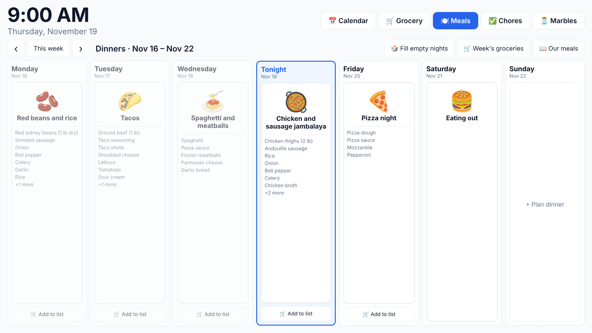
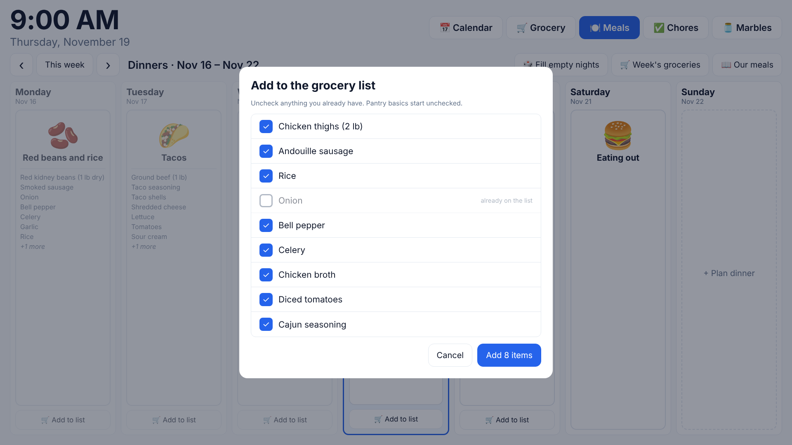

# Meal planning

The **🍽️ Meals** button at the top of the wall screen opens this week's dinners, Monday to Sunday. Tonight's card is outlined in blue, and nights that have passed are faded.

## First time: add the starter meals

The first time you open Meals there are no saved meals, so you'll see a card offering **Add starter meals**. Tap it to get 11 family dinners, each with a grocery list:

Tacos, spaghetti and meatballs, red beans and rice, chicken and sausage jambalaya, chicken and sausage gumbo, breakfast for dinner, grilled cheese and tomato soup, pizza night, chicken tenders and fries, plus **Leftovers** and **Eating out** (these two have no ingredients).

You can change or delete every one of them. Skip the starters if you'd rather build your own list.

## Planning a night

Tap any night's card. A window opens with two tabs:

- **📖 Our meals** shows your saved meals. Tap one to put it on that night. The search box at the top narrows the list, and **＋ New meal** lets you type in a new one (it's saved and planned in one step).
- **💡 Get ideas** shows a few random dinners from TheMealDB, a free recipe site, with photos. **🎲 Surprise me** gives you a fresh batch. You can also search by dish or ingredient, like "chicken", "shrimp" or "jambalaya". Tap **Plan it** to save that meal (with its ingredients and recipe link) to your meals and put it on the night.

When a night already has a meal, the bottom of that window also has:

- **✎ Edit** to change the meal,
- **Recipe ↗** if the meal has a recipe link (handiest on a phone),
- **Clear this night** to empty it.

To plan ahead, use **›** at the top to go to next week. **This week** brings you back.

## Fill empty nights

**🎲 Fill empty nights** puts a different saved meal on every empty night of the week you're looking at. It won't repeat a meal that's already planned that week, and it never picks Leftovers or Eating out (place those yourself). Afterwards, tap any night to swap it.

## Sending ingredients to the grocery list

- **🛒 Add to list** under a night adds that one meal's ingredients.
- **🛒 Week's groceries** at the top adds everything planned for the week. An ingredient used in two meals shows up once, labelled with both meals.

Either way, you get a checklist first:

- Uncheck anything you already have at home.
- Pantry basics (salt, pepper, oil, flour, sugar, butter, water and similar) start unchecked.
- Anything already on the grocery list is greyed out as "already on the list", so nothing is added twice. "Onion (2)" counts as the same thing as "Onion".

Tap **Add N items** and they appear on the 🛒 Grocery list right away, on the wall and on every phone.

## Your meals: editing and adding

**📖 Our meals** at the top shows every saved meal. Tap one to edit it:

- **Icon**: tap it to pick one of the pastel icons (or type any emoji), shown when the meal has no photo.
- **Name**.
- **Ingredients**: one per line, exactly as you'd like them to appear on the grocery list. An amount in brackets works well, like `Ground beef (1 lb)`.
- **Recipe link**: optional. Paste a link from anywhere (Allrecipes, Pinterest, a YouTube video).

**Delete** removes the meal and clears it from any night it was planned on.

## Where the ideas come from

Ideas come from [TheMealDB](https://www.themealdb.com), a free recipe database with a few hundred meals and photos. It needs no account or key. The app uses its public test key, which TheMealDB allows for personal projects like this one. Desserts, starters, sides and breakfasts are left out of the random ideas, but searches return everything.

The wall screen needs internet to show ideas and their photos (it already needs it for weather). If it can't reach TheMealDB, the Get ideas tab says so, and everything else keeps working.

### If you want more later

- **Mealie** is a free, self-hosted recipe manager that can import a recipe from almost any website link. It runs in Docker on the same PC as this app. If your saved recipes outgrow the simple meal box, the wall's meal plan could be connected to it.
- **Plan to Eat** (about $5 a month) and **Paprika** (one-time purchase) are polished apps, but they have no way to feed the wall screen, so you'd be keeping two lists in step.

## On a phone

The same Meals page works on a phone browser at the wall's address (for example `http://<pc-name>:8000`). The nights stack in a single column, and changes show on the wall within a second.
