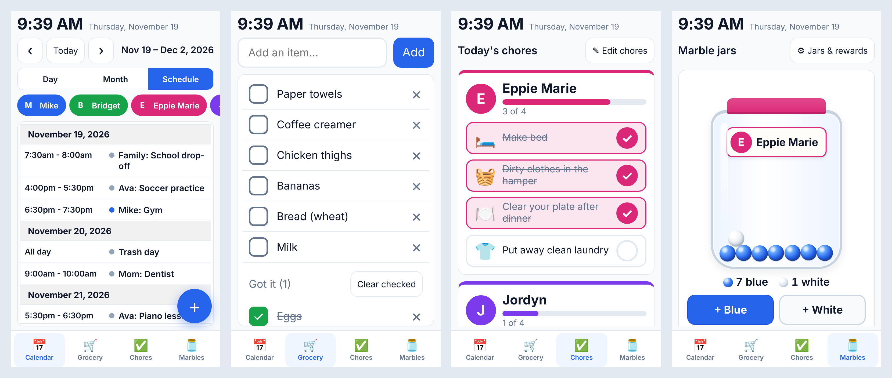

# Use the calendar on your phone

The same app that runs on the wall works on any phone. There is nothing extra to install on the
server: when the screen is narrow (a phone held upright), the app switches to a phone layout with
tabs along the bottom. Anything you change on a phone, like checking off "Milk" at the store or
giving Aaron a blue marble, shows up on the wall screen within a second, and the other way round.



There are two ways for a phone to reach the app:

| | Home Wi-Fi | Tailscale |
|---|---|---|
| Works at home | Yes | Yes |
| Works at the store, at work, on cellular | No | Yes |
| Setup | Nothing, just an address | Tailscale app on each phone |
| Address | `http://192.168.x.x:8000` | `http://your-pc:8000` (or `https://your-pc.your-tailnet.ts.net`) |

**Recommended: set up Tailscale.** It works everywhere, the address never changes, and the app
stays private to your family's devices. Home Wi-Fi is handy for a quick test first.

> **Keep it private.** The app has no login, so anyone who can reach it can change things. Never
> forward port 8000 on your router, and never run `tailscale funnel` for it. Home Wi-Fi and
> Tailscale (including `tailscale serve`, below) only let your own devices in.

---

## 1. Quick test on home Wi-Fi

1. Make sure the app is running on your PC (`docker compose up -d --build` in the
   `family-calendar` folder) and opens at `http://localhost:8000` on the PC.
2. Find the PC's address on your home network. In a terminal on the PC:

   ```bash
   hostname -I
   ```

   The first number, something like `192.168.1.42`, is the one you want.
3. On a phone connected to the **same Wi-Fi**, open the browser and go to
   `http://192.168.1.42:8000` (use your number).

You should see the calendar with tabs along the bottom.

**If it doesn't load:**

- Check the phone is on your home Wi-Fi, not cellular or a guest network.
- If the PC has the `ufw` firewall turned on, allow the port: `sudo ufw allow 8000/tcp`.
- The address can change when the router restarts. Your router's settings page usually has a
  "DHCP reservation" or "static lease" option to give the PC a fixed address. Tailscale avoids
  this problem entirely.

---

## 2. Tailscale (works from anywhere)

Tailscale makes a private network out of your own devices. Your PC already has it.

### On each phone

1. Install **Tailscale** from the App Store (iPhone) or Play Store (Android).
2. Open it and sign in.
   - **Your phone:** sign in with the same account you use on the PC.
   - **Bridget's phone (and later the kids'):** either sign in with your account too, which is
     simplest, or invite her as her own user from the Tailscale admin console
     (<https://login.tailscale.com/admin/users>, "Invite users") so she has her own login.
3. Turn the VPN switch on when it asks. Tailscale only routes traffic for your own devices
   through it; everything else goes over the internet as normal, and it is fine to leave it on.

### Find the PC's Tailscale name

Open <https://login.tailscale.com/admin/machines>. Your PC is listed with a name (for example
`mike-pc`) and an address starting with `100.`.

On the phone, open `http://mike-pc:8000` (use your PC's name). If the name doesn't work, use the
`100.x.y.z` address instead: `http://100.101.102.103:8000`. MagicDNS, which makes names work, is
on by default for new accounts; you can check it under **DNS** in the admin console.

This address works at home and away, so use it on every phone instead of the Wi-Fi one.

### Optional, recommended: a proper `https://` address

Phones treat a site on `https://` as a real app: Android then offers **Install app**, which opens
full screen with its own icon in the app drawer. Tailscale can give the PC a private `https://`
address for free.

1. In the admin console, open **DNS** and make sure **MagicDNS** is on, then scroll down and
   click **Enable HTTPS**.
2. On the PC, run:

   ```bash
   sudo tailscale serve --bg 8000
   ```

   It prints an address like `https://mike-pc.tail1234.ts.net`. This stays on after restarts.
3. Use that address on the phones.

`tailscale serve` only shares the app with devices signed in to your Tailscale, not the internet.
To see what is being served, run `tailscale serve status`; to stop it, `sudo tailscale serve reset`.

---

## 3. Put it on the home screen

So it opens like an app, with the family calendar icon and no browser bars:

**iPhone (Safari):** open the address, tap the **Share** button (square with an arrow), scroll
down, tap **Add to Home Screen**, then **Add**.

**Android (Chrome):** open the address, tap the **⋮** menu, then **Install app** or **Add to
Home screen**. On a plain `http://` address Android only makes a shortcut that opens in Chrome;
with the `https://` address from the step above it installs as a full-screen app.

Do this on each family phone. If you add the home-screen icon while using the Wi-Fi address
and later switch to Tailscale, delete the icon and add it again from the new address.

---

## What's different on the phone

- **Tabs along the bottom:** Calendar, Grocery, Chores, Marbles (and Meals once meal planning is
  merged). These are the same screens as the wall, laid out to fit.
- **Calendar** opens on the two-week **Schedule** list, which is the easiest to read on a small
  screen. **Day** and **Month** are there too; Week is left out because seven columns don't fit.
  Tap **+** to add an event.
- **No photo slideshow and no "back to today" timer.** Those are for the wall screen only, so your
  phone won't jump around while you're using it.
- **Settings** works, but set up Google Photos from the wall screen or the PC, since its sign-in
  link points to the address in `PUBLIC_URL`.

The wall screen is unchanged.

---

## Later: when the app moves to the Pi

If you move the app from your PC to the Raspberry Pi, install Tailscale on the Pi
(`curl -fsSL https://tailscale.com/install.sh | sh` then `sudo tailscale up`), run
`sudo tailscale serve --bg 8000` there, and point the phones at the Pi's name instead. Delete
and re-add the home-screen icons with the new address.
