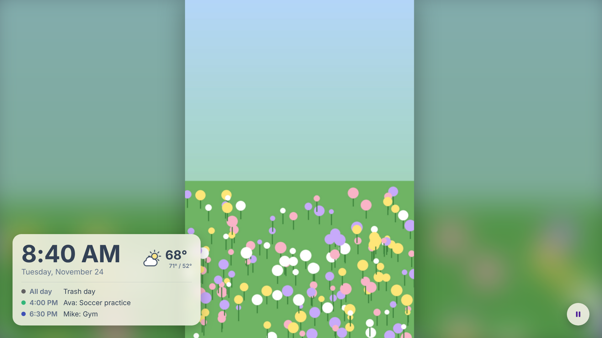

# Photo screensaver



When nobody has touched the wall for a while (10 minutes to start with), it fades into a full-screen
slideshow of your family photos. Tall phone photos get a soft blurred edge instead of black bars,
and each photo drifts slowly. A pastel card in the corner shows the time, today's weather and the
next few things on today's calendar.

## Adding photos from your phone or iPad

1. Open the calendar on your phone or iPad (the Tailscale address, see docs/phone-setup.md).
2. Tap **Settings > Photos > Add photos**. Your camera roll opens.
3. Tick as many photos as you like and tap **Add**. The screen shows "Adding photos… 3 of 12"
   while they go up, and they join the slideshow on the wall straight away.

Each photo is turned the right way up, shrunk to 2048 px (plenty for the 27" screen) and saved as a
JPG. Location and camera details are dropped. Adding the same photo twice keeps one copy. You can
also use **Add photos** from a computer's browser, or copy jpg, png or webp files straight into
`data/photos/` in the calendar folder on the PC.

To remove a photo, tap its **×** in Settings > Photos. **Remove all** clears the lot (it asks first).

## Videos

**Add photos** takes MP4 videos too (Android's normal format). They're kept as they are, play muted
and all the way through, then the slideshow moves on. A long clip plays its first minute. Pause and
swipe work the same as for photos.

If the phone records in **HEVC / high-efficiency** video, the upload says that clip can't play on the
wall instead of adding a blank slide. Turn that setting off in the phone's camera for future clips.
iPhone .mov videos aren't taken for now.

## Using the slideshow

- **Photos button** (left rail, just above Settings) starts the slideshow straight away, even
  during night hours. With no photos yet it opens Settings > Photos.

- **Swipe left** for the next photo, **swipe right** to go back to the one before.
- **Pause** (round button, bottom right) keeps the current photo up until you tap play or leave.
  "Paused" shows beside it so nobody wonders why it stopped.
- **Tap anywhere else** to go back to the calendar. The tap won't open whatever event is underneath.
- **Preview slideshow** in Settings > Photos does the same.

## Settings (Settings > Photos)

| Setting | What it does | Starts at |
| --- | --- | --- |
| Start after | Minutes with nobody touching the wall before the slideshow starts | 10 min |
| Each photo | How long each photo stays up | 15 seconds |
| Show time, weather and what's next | The pastel card in the corner. Off leaves a small clock only | On |
| Dim clock instead of photos at night | During night hours the wall shows only a dim grey clock on black, which moves a little each minute so nothing burns into the screen. It works even with no photos | On, 9 PM to 6 AM |

Changes save straight away and apply to the wall without a refresh. The slideshow doesn't start on
phones, while a dialog is open, or while a morning or bedtime routine is up on the wall.

The first two can also be set in `.env` (`SCREENSAVER_MINUTES`, `SLIDE_SECONDS`). Whatever you
pick in the app wins.

## Optional: Google Photos

You don't need this. Uploading from your phone covers the same ground. Google no longer lets apps
show a whole album or follow new photos, so with Google you still choose photos by hand each time;
the difference is that you pick them from Google Photos (including shared albums) by scanning a QR
code on the wall.

### One-time Google setup (about 10 minutes)

Use the same Google Cloud project as the calendar service account.

1. **APIs & Services > Library**: enable **Photos Picker API**.
2. **APIs & Services > OAuth consent screen** (called **Google Auth Platform** in newer consoles):
   - User type **External**, app name `Family Calendar`, your email for support and developer contact.
   - Scopes: add `.../auth/photospicker.mediaitems.readonly`.
   - Audience: add your Google account as a **test user**, then click **Publish app** so it shows
     **In production**. (While it is in "Testing", Google expires the sign-in after 7 days. Since it is
     unverified, the sign-in page shows a "Google hasn't verified this app" warning. Click
     **Advanced > Go to Family Calendar**. That's expected for a personal app.)
3. **Credentials > Create credentials > OAuth client ID**:
   - Application type **Web application**.
   - Authorised redirect URI: `http://localhost:8000/api/photos/auth/callback`
4. Copy the client ID and secret into `.env`:

   ```bash
   GOOGLE_OAUTH_CLIENT_ID=....apps.googleusercontent.com
   GOOGLE_OAUTH_CLIENT_SECRET=...
   PUBLIC_URL=http://localhost:8000
   ```

   then `docker compose up -d`.

> Google only allows plain `http://` redirect addresses for `localhost`. So do the one-time sign-in
> **on the wall screen itself** (when the Pi runs the backend), or in a browser on the Linux PC
> (when the PC runs the backend). After that, picking photos works from any phone.

### Picking from Google Photos

1. On the wall: **⚙ Settings > Photos > Connect Google Photos**, then sign in. You only do this once.
2. Tap **Choose photos**. A QR code appears. Scan it with a phone that's signed in to the same
   Google account, pick photos, and tap **Done**. Or tap **Or choose on this screen**.
3. The wall copies them (up to 2048 px) into `data/photos/` and they join the slideshow. Remove any
   photo with its ×, or all of them with **Remove all**. **Preview slideshow** starts it right away.

Videos are skipped for now.
