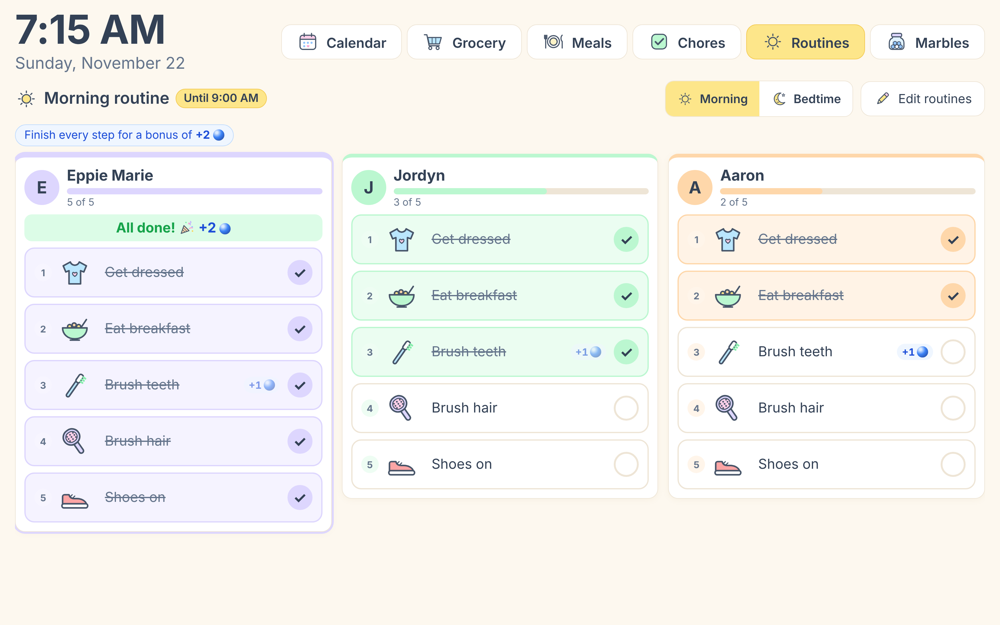
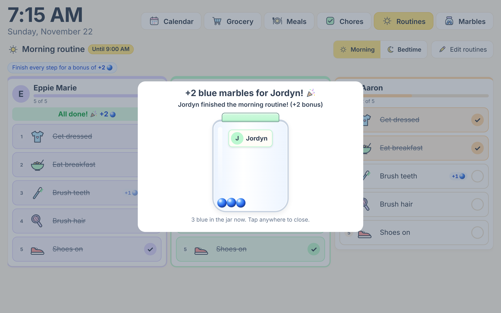

# Morning and bedtime routines

The **Routines** tab shows a short checklist for each kid: a morning routine (get dressed, eat breakfast,
brush teeth...) and a bedtime routine (bath, pajamas, brush teeth, read a book...). Kids tap each step as
they do it. Every day starts fresh at midnight.

## Morning in the morning, bedtime in the evening

Each routine has a start and end time (6:00 to 9:00 AM and 7:00 to 9:00 PM to start with).

- The Routines tab shows whichever routine is on right now. Outside those times it shows the next one
  coming up. The **Morning / Bedtime** buttons at the top switch by hand.
- On the wall screen, when a routine starts and nobody has touched the screen for 2 minutes, the wall
  switches to the Routines tab by itself. While a routine is on, the screen goes back to Routines (not the
  calendar) after 2 minutes untouched, and the photo slideshow waits until the routine is over. When the
  routine ends, the wall goes back to the calendar.
- You can turn that switching off in the editor ("Switch the wall to the routine during these times").
- Phones never switch by themselves; open the Routines tab when you want it.

The tab's icon is a sun in the morning and a moon at bedtime.

## Setting it up

The first time you open Routines, pick the kids and tap **Add starter routines**. Each kid gets:

- **Morning:** get dressed, eat breakfast, brush teeth, brush hair, shoes on, backpack ready (school days only)
- **Bedtime:** bath or shower, pajamas on, brush teeth, clothes in the hamper, read a book, lights out

Then tap **✎ Edit routines** to change anything:

1. Pick **Morning routine** or **Bedtime routine** at the top.
2. Set the **Starts** and **Ends** times for that routine. They can't overlap the other routine.
3. Tap a kid's name to see their steps.
4. For each step you can change the icon (tap it to pick from the app's icons), the name, the days it
   shows (tap a letter to turn a day on or off, so "Backpack ready" can be school days only), how many blue
   marbles it earns, and its order (▲ ▼). **×** deletes a step.
5. **+ Add step** adds a new step for that kid. **Copy steps from…** copies another kid's whole routine,
   handy when the kids do the same things.

There are new icons for routines too: shoes, backpack, moon, bath, hairbrush, cereal bowl, socks, soap,
cup and potty, next to the existing toothbrush, shirt, bed and book.

## Marbles

Routines can earn blue marbles the same way chores do ([chore marbles](chore-marbles.md)):

- **Per step:** set the blue-marble number on a step (0 to 20). Checking it off drops that many blue
  marbles into the kid's jar.
- **Finish bonus:** "Bonus for finishing it all" at the top of the editor (one number per routine). When a
  kid checks off their last step, they get the bonus and a popup says they finished.

Unchecking a step (a mis-tap) takes its marbles back, and the bonus too, since the routine isn't finished
anymore. Checking it again gives them back. Only kids with a marble jar get marbles; everyone else just gets
the checkmarks and a "finished!" cheer. Both start at 0, so nothing changes in the jars until you set them.
