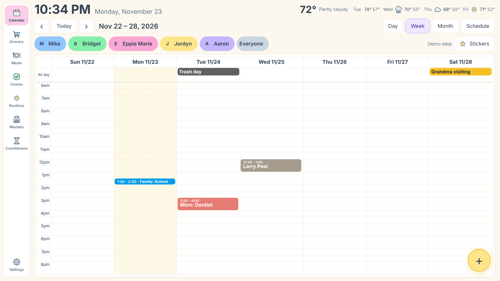
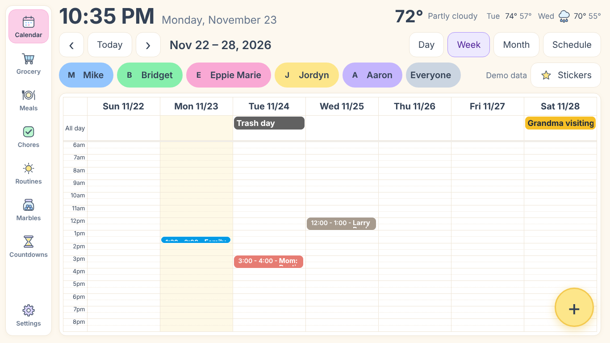

# Screen layout: side rail and week view

## What changed

- **Page buttons moved to a rail on the left.** Calendar, Grocery, Meals, Chores, Routines, Marbles and Countdowns are stacked down the left edge, each with its icon and a small label. Settings sits at the bottom of the rail (it used to be next to Stickers).
- **Slimmer top line.** The clock and date share one line on the left, and the weather sits on the right. With the page buttons gone from the top, the weather no longer gets pushed off the edge.
- **Week and day views always show 6 AM to 9 PM** with no scrolling. The rows stretch to fill whatever height the screen has.
- **Bigger event text.** Event titles are bold and larger. Half-hour events put the time and title on one line.

## How it adapts to different screens

The browser decides the layout from the window size in pixels, so the same app looks right on the wall screen, a laptop and a phone:

| Window width | Weather shows |
|---|---|
| Wider than 1500 px (a 1080p wall screen) | Today plus 4 days |
| 1200 to 1500 px (most laptops) | Today plus 2 days |
| 700 to 1200 px | Just the temperature |
| 700 px or narrower (phones) | The phone layout: tabs along the bottom, as before |

If the window is shorter than 900 px (a laptop with browser toolbars), the hour labels get smaller so 6 AM to 9 PM still fits. On a full 1080p screen it has plenty of room.

## Things to know

- **Events after 9 PM don't show in the week or day view.** They still show in Month and Schedule. If you'd like the week view to run later (say to 10 PM), it's one setting in `frontend/src/App.jsx` (`slotMaxTime`); each extra hour makes every row a little shorter.
- **Browser zoom changes the size.** If text looks too big or small on a particular screen, Ctrl + plus / Ctrl + minus zooms the page, and the layout adjusts to match. Ctrl + 0 resets it. The Pi kiosk runs full screen, so it gets the most room.
