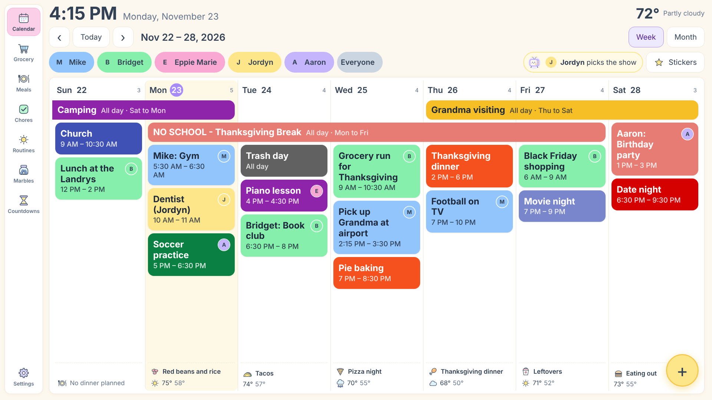
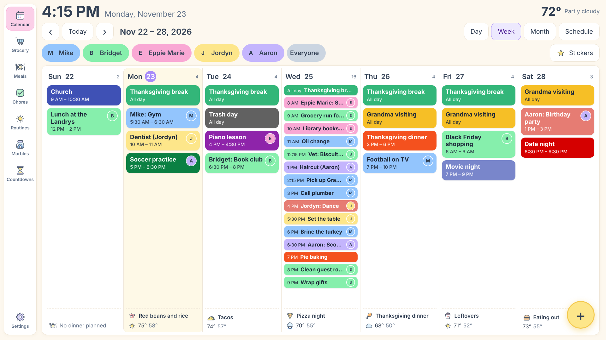
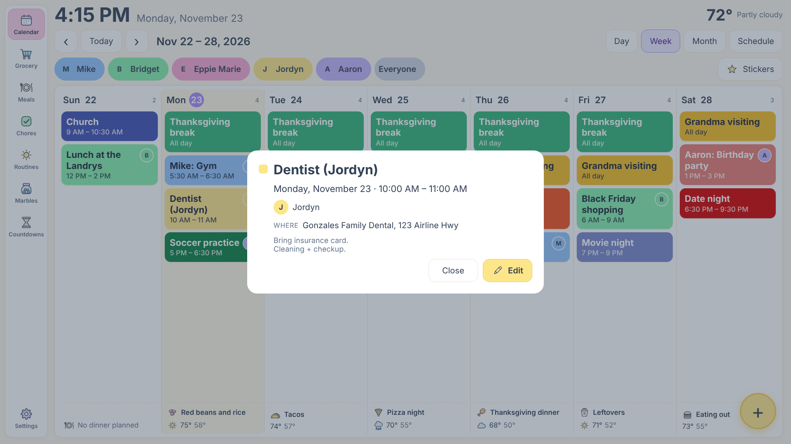

# Screen layout: side rail, week view and event details

## Side rail and top line

- **Page buttons are in a rail on the left.** Calendar, Grocery, Meals, Chores, Routines, Marbles and Countdowns are stacked down the left edge, each with its icon and a small label. Settings sits at the bottom of the rail.
- **Slim top line.** The clock and date on the left, the current weather on the right. Each day's forecast lives at the bottom of its column in the Week view instead.

## Week view: a column per day

- Each day is a column: the day and date at the top (today's date is circled), a small count of that day's events, then the events as cards in time order. All-day events come first. Each card shows the title, the time and the person's initial, and is only as tall as its text, so there are no empty hours.
- **Card size follows the week.** When no day has more than 3 events the cards are big; up to 5 they're medium; busier weeks get standard cards.
- **Busy days.** A day with 8 or more events switches to one-line cards (start time and title). If it still doesn't fit, only that day's column scrolls, and its bottom edge fades out so you can tell there's more. The other days stay put.
- **Day footers.** The bottom of each column shows that night's dinner from the Meals page and that day's weather (icon, high and low). The forecast reaches 5 days ahead, so past days and days further out show dinner only.
- **Events across several days join into one bar** under the day headings, like a visit or a school break. That also works when the same all-day event (same title and colour) was entered separately on back-to-back days, like "NO SCHOOL" Monday to Friday. Bars that start before or run past this week have a square end on that side, and each day's cards start right under the bars that cross that day. Tap a bar to see the event.
- Tap empty space in a column (or "+ Add" on an empty day) to add an event that day. Stickers work here too.
- **Swipe** left or right anywhere on the calendar to go to the next or previous week (or month in Month view). The calendar follows your finger, sweeps off the side and the new week slides in. A short drag springs back. The arrow and Today buttons slide too.
- **Show night** sits next to the Stickers button: the TV, the kid's picture and "picks the show". Tap it to go to the Marbles page, where Swap is.

## Tap an event to see it first

Tapping an event (in Week or Month) opens its details: the date and time, who it's for, where, any notes from Google Calendar, and whether it repeats. Nothing changes until you tap **Edit**, which opens the same form as before. Close, or tapping outside, goes back to the calendar.

## Views

The wall has **Week** and **Month**. Phones have **Month** and **Schedule** (a two-week list), because seven columns don't fit on a phone.

## Different screens

The browser picks the layout from the window size, so the same app works on the wall screen, a laptop and a phone:

| Window width | What changes |
|---|---|
| Wider than 1200 px | Full layout, weather shows temperature and conditions |
| 700 to 1200 px | Weather shows just the temperature |
| 700 px or narrower (phones) | The phone layout: tabs along the bottom, Month and Schedule views. |

If text looks too big or small on a particular screen, Ctrl + plus / Ctrl + minus zooms the page and the layout adjusts. Ctrl + 0 resets it. The Pi kiosk runs full screen, so it gets the most room.

